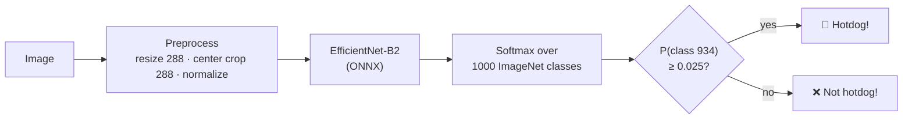

# 🌭 SeeFood

[](https://github.com/skateddu/seefood/actions/workflows/ci.yml)
[](https://skateddu.github.io/seefood/)
[](https://www.python.org/)
[](LICENSE)
[](https://github.com/astral-sh/uv)
[](https://github.com/astral-sh/ruff)
[](https://onnxruntime.ai/)
[](https://huggingface.co/datasets/antareepdey/Hotdog-or-not-a-hotdog)
[](https://github.com/skateddu/seefood/commits/main)

A faithful, over-engineered reproduction of **SeeFood**, the "Shazam for food" from HBO's *Silicon Valley*,
which can recognize exactly one food: the hotdog.

**Try it in your browser: [skateddu.github.io/seefood](https://skateddu.github.io/seefood/)**. Take a photo with
your phone or computer camera, or drop one on the page; the model runs locally and your photo never leaves the device.

## Features

- **No training**: reuses the `hotdog` class (index 934) of a pretrained ImageNet classifier
- **Accurate**: 98.0% accuracy on the test split of a hotdog / not hotdog dataset, with a calibrated threshold
- **Lightweight runtime**: ONNX Runtime + NumPy + Pillow, no PyTorch at inference time
- **Single-file model**: EfficientNet-B2 exported to ONNX (~37 MB) with the softmax inside the graph,
  shipped with the package
- **Verified export**: ONNX outputs match PyTorch, and the NumPy preprocessing matches torchvision's
  transforms exactly
- **Reproducible calibration**: one script downloads the dataset, removes train/test duplicates and
  picks the threshold
- **CLI**: `seefood lunch.jpg` answers 🌭 Hotdog! or ❌ Not hotdog!, with JSON Lines output for scripts
- **Web demo**: a static page on GitHub Pages running the same model with onnxruntime-web, entirely
  in the browser, with the same verdict as the CLI on all 20 images checked

## How It Works

ImageNet-1k already contains a `hotdog, hot dog, red hot` class (index **934**), so a pretrained
ImageNet classifier does all the work: if the probability of class 934 reaches a calibrated
threshold, it's a hotdog. Otherwise, it's not a hotdog.



| Module | Responsibility |
| --- | --- |
| `config.py` | `ClassifierConfig`: model path, threshold, input size, normalization |
| `preprocess.py` | Image loading with EXIF orientation, bicubic resize, center crop, normalization to an NCHW tensor |
| `classifier.py` | ONNX Runtime session and the threshold decision rule |
| `exceptions.py` | `SeeFoodError` hierarchy: config, image and model loading errors |
| `main.py` | `seefood` command: argument parsing, output formatting, error handling and exit codes |

The classifier receives the ONNX session from the outside, so unit tests run on a fake session
without loading the model.

The web demo runs the same pipeline in JavaScript. `scripts/build_site.py` writes the threshold,
input size and normalization from `ClassifierConfig` into the site's `config.json`, so the browser
and the Python package can't drift apart.

| Web file | Responsibility |
| --- | --- |
| `seefood.js` | Model download with progress, preprocessing on a canvas, classification |
| `app.js` | Page logic: file picker, live camera with shutter, drag and drop, paste, verdict banner |
| `index.html`, `style.css` | The SeeFood screen |

The browser's canvas resampling is not exactly Pillow's bicubic resize, so probabilities differ
slightly: `scripts/web_parity.py` checks 20 test images in headless Edge, with the same verdict on
all of them and a largest probability difference of 0.023.

## Model

| | |
| --- | --- |
| Architecture | EfficientNet-B2 (`torchvision`, `IMAGENET1K_V1` weights) |
| ImageNet top-1 | 80.6% |
| Parameters | 9.1M (~37 MB as ONNX) |
| Input | 288×288 RGB, bicubic resize, ImageNet mean/std normalization |
| Output | softmax probabilities over the 1000 ImageNet classes (baked into the ONNX graph) |

EfficientNet-B2 was picked as the best accuracy/size trade-off: smaller models (EfficientNet-B0, MobileNetV3)
lose 3–5 points of ImageNet accuracy, larger ones (EfficientNetV2-S, ConvNeXt-Tiny) are 2–3× heavier
to download in the browser.

## Threshold Calibration

A raw ImageNet classifier spreads probability over related classes (cheeseburger, bagel, French loaf…),
so the hotdog probability is often low even on an actual hotdog. The decision threshold on
P(class 934) is calibrated with `scripts/calibrate.py` on the
[Hotdog or not a hotdog](https://huggingface.co/datasets/antareepdey/Hotdog-or-not-a-hotdog) dataset
(Apache-2.0), whose negatives mix other dishes with people, animals and objects:

- **Calibration** on the *train* split (1550 hotdogs, 1503 others), picking the threshold that maximizes F1.
  47 train images that also appear in the test split are dropped to avoid leakage.
- **Evaluation** on the *test* split (100 hotdogs, 100 others).

| Test split | Threshold | Accuracy | Precision | Recall | F1 |
| --- | --- | --- | --- | --- | --- |
| Naive | 0.5 | 93.5% | 100.0% | 87.0% | 0.930 |
| **Calibrated** | **0.025** | **98.0%** | **99.0%** | **97.0%** | **0.980** |

A 2.5% probability sounds tiny, but out of 1000 classes it's a strong signal: the model rarely gives
the hotdog class any mass unless there's a hotdog in the picture. With only 200 test images, these
numbers are indicative rather than precise.

## Project Structure

```text
seefood/
├── src/seefood/
│   ├── __init__.py               # Package version
│   ├── config.py                 # ClassifierConfig (frozen dataclass, validated)
│   ├── exceptions.py             # SeeFoodError → ConfigError, ImageLoadError, ModelLoadError
│   ├── preprocess.py             # Load, resize, crop, normalize (matches torchvision)
│   ├── classifier.py             # HotdogClassifier, Prediction, ONNX session loading
│   ├── main.py                   # CLI entry point (argparse)
│   ├── __main__.py               # `python -m seefood` entry point
│   └── assets/
│       └── efficientnet_b2.onnx  # Exported model, shipped with the package
├── scripts/
│   ├── export.py                 # PyTorch → ONNX export with parity checks
│   ├── calibrate.py              # Dataset download, threshold calibration, test metrics
│   ├── build_site.py             # Web demo build (web/ + model + config.json) and local server
│   └── web_parity.py             # Browser vs Python predictions in headless Edge
├── web/
│   ├── index.html                # The SeeFood screen
│   ├── style.css                 # Mustard, ketchup and relish
│   ├── app.js                    # Page logic: photo input, camera and verdict
│   └── seefood.js                # onnxruntime-web model, preprocessing, classification
├── tests/
│   ├── conftest.py               # Shared fixtures: config, fake ONNX session, image factories
│   ├── unit/                     # Fast tests, no model loading
│   └── integration/              # Tests on the real ONNX model (marker: integration)
├── .github/workflows/
│   ├── ci.yml                    # Ruff + pytest on Python 3.10–3.13, integration tests
│   └── pages.yml                 # Builds and deploys the web demo to GitHub Pages
├── data/                         # Downloaded datasets (git-ignored)
├── pyproject.toml
├── uv.lock
├── CHANGELOG.md
└── LICENSE
```

## Dependencies

| Package | Description | Link |
| --- | --- | --- |
| [ONNX Runtime](https://onnxruntime.ai/) | Runs the exported model on CPU | [Docs](https://onnxruntime.ai/docs/) |
| [NumPy](https://numpy.org/) | Tensor preprocessing and probability handling | [Docs](https://numpy.org/doc/stable/) |
| [Pillow](https://python-pillow.org/) | Image decoding, resize and crop | [Docs](https://pillow.readthedocs.io/) |

The optional `export` group is only needed to rebuild the ONNX model:

| Package | Description | Link |
| --- | --- | --- |
| [PyTorch](https://pytorch.org/) | Runs the original model and the `torch.export`-based ONNX exporter | [Docs](https://docs.pytorch.org/docs/stable/) |
| [torchvision](https://pytorch.org/vision/) | Pretrained EfficientNet-B2 weights and reference transforms | [Docs](https://docs.pytorch.org/vision/stable/) |
| [ONNX](https://onnx.ai/) | ONNX model format | [Docs](https://onnx.ai/onnx/) |
| [ONNX Script](https://github.com/microsoft/onnxscript) | Required by the `torch.export`-based exporter | [GitHub](https://github.com/microsoft/onnxscript) |

The web demo loads [onnxruntime-web](https://onnxruntime.ai/docs/tutorials/web/) 1.30.0 from the
jsDelivr CDN and the [Bricolage Grotesque](https://fonts.google.com/specimen/Bricolage+Grotesque)
font from Google Fonts; it has no bundler and no npm dependencies.

Development tools (`dev` group, installed by default): [pytest](https://docs.pytest.org/),
[pytest-cov](https://pytest-cov.readthedocs.io/) and [Ruff](https://docs.astral.sh/ruff/).

## Installation

Requires Python >= 3.10 and [uv](https://docs.astral.sh/uv/).

```bash
git clone https://github.com/skateddu/seefood.git
cd seefood
uv sync
```

## Quick Start

### CLI

`uv sync` installs a `seefood` console command; `python -m seefood` works identically.

```bash
uv run seefood lunch.jpg dinner.jpg
```

```text
🌭 Hotdog! lunch.jpg (p = 0.715)
❌ Not hotdog! dinner.jpg (p = 0.000)
```

With `--json`, each image becomes one JSON object per line (JSON Lines):

```bash
uv run seefood --json lunch.jpg
```

```json
{"path": "lunch.jpg", "is_hotdog": true, "hotdog_probability": 0.71492}
```

Images that cannot be read are reported on stderr and skipped; the other images are still
classified.

| Option | Default | Description |
| --- | --- | --- |
| `images` | (required) | One or more image files |
| `--threshold` | `0.025` | Minimum hotdog probability to answer "Hotdog!" |
| `--model` | bundled `efficientnet_b2.onnx` | ONNX model file |
| `--json` | text output | Print one JSON object per image |
| `-v`, `--verbose` | warnings only | Debug logging for SeeFood's own messages |
| `--version` | | Print the version and exit |

| Exit code | Meaning |
| --- | --- |
| `0` | Every image was classified (hotdog or not) |
| `1` | At least one image could not be loaded, or the model/config is invalid |
| `2` | Invalid command-line usage |

### Python API

```python
from pathlib import Path

from seefood.classifier import HotdogClassifier
from seefood.config import ClassifierConfig

config = ClassifierConfig()
classifier = HotdogClassifier.from_config(config)
prediction = classifier.predict(path=Path("lunch.jpg"))

print("🌭 Hotdog!" if prediction.is_hotdog else "❌ Not hotdog!")
print(f"P(hotdog) = {prediction.hotdog_probability:.3f}")
```

### Configuration

`ClassifierConfig` is a frozen dataclass passed explicitly to the classifier; invalid values raise
`ConfigError`.

| Field | Default | Description |
| --- | --- | --- |
| `model_path` | bundled `efficientnet_b2.onnx` | ONNX model returning probabilities over the ImageNet classes |
| `threshold` | `0.025` | Minimum probability of the hotdog class to answer "Hotdog!" (in [0, 1]) |
| `hotdog_class_index` | `934` | Index of the hotdog class in ImageNet-1k |
| `image_size` | `288` | Shorter-side resize target and center-crop size |
| `mean` / `std` | ImageNet statistics | Per-channel normalization, RGB order |

### Web Demo Locally

```bash
uv run python scripts/build_site.py --serve
```

Then open <http://127.0.0.1:8000>. The site is built into `build/site` (git-ignored).
To compare the browser's predictions with the Python package (requires the dataset downloaded by
`calibrate.py` and Microsoft Edge on Windows; pass `--browser` for another Chromium-based browser):

```bash
uv run python scripts/web_parity.py
```

### Rebuilding the Model

The ONNX file ships with the repository, so this is only needed to regenerate it:

```bash
uv sync --group export
uv run python scripts/export.py
```

The script exports with the `torch.export`-based exporter (opset 18) and checks that ONNX Runtime
matches PyTorch outputs and that the NumPy preprocessing matches torchvision's transforms.

### Recalibrating the Threshold

Downloads ~170 MB into `data/` (git-ignored) and prints the metrics table shown above:

```bash
uv run python scripts/calibrate.py
```

## Deployment

Two GitHub Actions workflows run on `main`:

- **CI** (`ci.yml`): Ruff lint and format check, unit tests with coverage on Python 3.10–3.13,
  and the integration tests on the real ONNX model.
- **Pages** (`pages.yml`): when the web demo, the package or the build script change, it builds the
  site with `scripts/build_site.py` and deploys it to GitHub Pages. There is no backend: inference
  happens in the visitor's browser.

## Testing

```bash
# Unit tests (default, no model loading)
uv run pytest

# With coverage (minimum 80%)
uv run pytest --cov

# Integration tests on the real ONNX model
uv run pytest -m integration
```

## References

- *Silicon Valley*, Season 4, Episode 4: "Teambuilding Exercise" (SeeFood's "Not hotdog")
- Tan & Le: [EfficientNet: Rethinking Model Scaling for Convolutional Neural Networks](https://arxiv.org/abs/1905.11946)
- torchvision: [EfficientNet-B2 weights](https://docs.pytorch.org/vision/stable/models/generated/torchvision.models.efficientnet_b2.html)
- PyTorch: [torch.export-based ONNX exporter](https://docs.pytorch.org/docs/stable/onnx_export.html)
- ONNX Runtime: [ONNX Runtime Web](https://onnxruntime.ai/docs/tutorials/web/)
- Dataset: [antareepdey/Hotdog-or-not-a-hotdog](https://huggingface.co/datasets/antareepdey/Hotdog-or-not-a-hotdog)

## License

[MIT](LICENSE). The ONNX model is derived from torchvision's pretrained EfficientNet-B2 weights,
ported from Ross Wightman's [timm](https://github.com/huggingface/pytorch-image-models) (Apache-2.0)
and trained on ImageNet, whose images are subject to their own terms of use.

SeeFood is a fan project, not affiliated with or endorsed by HBO. *Silicon Valley* and SeeFood are
property of their respective owners.
